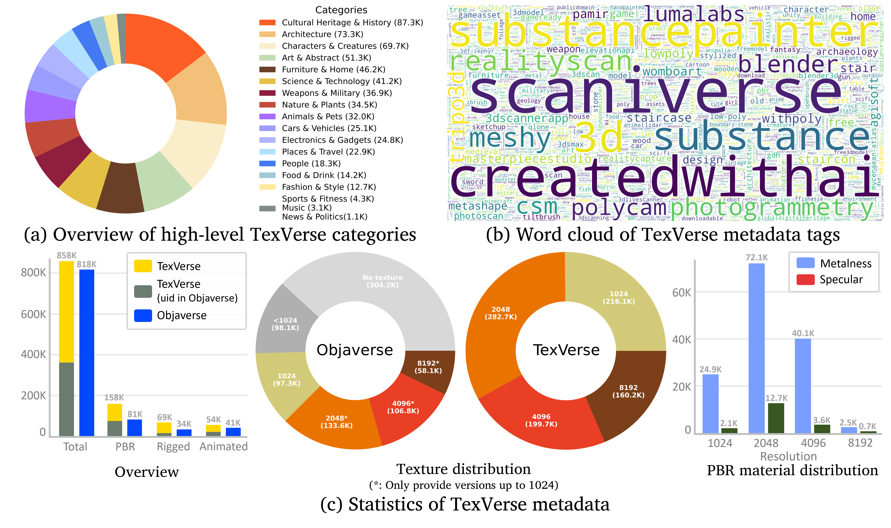

<div align="center">
<h1 align="center" >
  TexVerse: A Universe of 3D Objects <br> with High-Resolution Textures
</h1>

  <a href='#'></a> &nbsp;
  <a href='https://arxiv.org/abs/2508.10868'></a> &nbsp;
<br>
  <a href='https://huggingface.co/datasets/YiboZhang2001/TexVerse'>
  </a> &nbsp;
  <a href='https://huggingface.co/datasets/YiboZhang2001/TexVerse-1K'>
  </a> &nbsp;
  <a href='https://huggingface.co/datasets/YiboZhang2001/TexVerse-Skeleton-Animation'>
  </a> &nbsp;
<br>
**[Yibo Zhang<sup>1,2</sup>](https://yiboz2001.github.io/),  [Li Zhang<sup>1,3</sup>](https://lzrobots.github.io/),  [Rui Ma<sup>2 &ast;</sup>](https://ruim-jlu.github.io/), [Nan Cao<sup>1,4</sup>](http://nancao.org/)** 
<br>
<sup>1</sup>Shanghai Innovation Institute
<sup>2</sup>Jilin University 
<sup>3</sup>Fudan University 
<sup>4</sup>Tongji University 
<br>
&ast; Corresponding Author

</div>


**TexVerse is a large-scale 3D dataset featuring high-resolution textures.**  Its key characteristics include:

1. **Scale & Source**: TexVerse dataset has **858,669 unique 3D models** curated from Sketchfab, including **158,518** with physically based rendering (PBR) materials.
2. **Variants**: Each model includes all high-resolution variants, resulting in a total of **1,659,097 3D instances**.
3. **Specialized Subsets**:
   For the rigged and animated categories of models, we further obtain the original user-uploaded file format to prevent the loss of skeletons and animations during the format conversion of Sketchfab. 
   - **TexVerse-Skeleton**: **69,138 rigged models**.
   - **TexVerse-Animation**: **54,430 animated models**.

   Note: We only successfully downloaded the source files for 87,414 models. For details, please refer to `model_paths.txt` in [TexVerse-Skeleton-Animation](https://huggingface.co/datasets/YiboZhang2001/TexVerse-Skeleton-Animation).
4. **Annotations**: Detailed model annotations covering overall characteristics, structural components, and fine-grained features.


Feel free to contact me ([ybzhang23@mails.jlu.edu.cn](mailto:ybzhang23@mails.jlu.edu.cn)) or open an issue if you have any questions or suggestions.


## News

- [2025-08-18] We have uploaded model thumbnails in [**TexVerse**](https://huggingface.co/datasets/YiboZhang2001/TexVerse).
- [2025-08-11] We have released the **TexVerse** dataset. Feel free to download it.

## Statistics



## Metadata

We provide the following metadata files.
- **TexVerse Dataset**  
  - Object ID list: `./metadata/TexVerse_id_list.txt`  
  - PBR material model ID list: `./metadata/TexVerse_pbr_id_list.txt`  
  - Annotations for a subset of 856,312 objects: `caption.json` in [**TexVerse**](https://huggingface.co/datasets/YiboZhang2001/TexVerse/blob/main/caption.json).
  - Dataset metadata: `metadata.json` in [**TexVerse**](https://huggingface.co/datasets/YiboZhang2001/TexVerse/blob/main/metadata.json).
    
    Example:
      ```
      "d14eb14d83bd4e7ba7cbe443d76a10fd": {
        "name": "\u26e8 The Forgotten Knight \u26e8",
        "description": "# The Forgotten Knight \nOnce a mighty warrior, abandoned by time but not by nature. His armor, entwined with crimson roses, stands as a testament to battles long past. No longer does he hear the clash of swords, only the whisper of petals in the wind. A silent guardian, a symbol of eternal memory and unfulfilled duty.\n\n---\n*Made and rig in Blender 4.3*\n\n---\n\n\n\n\n",
        "user": "dark_igorek",
        "user_display": "dark_igorek",
        "tags": [
          "armor", "rig", "medeival", "roses", "crusader", "substaincepainter", "fantasycharacter", "rigged-character", "character", "blender", "art", "free", "sword", "fantasy", "download", "rigged", "knight"
        ],
        "categories": [
          "Art & Abstract",
          "Characters & Creatures"
        ],
        "vertexCount": 135405,
        "faceCount": 223719,
        "max_texture": 2048,
        "pbrType": "metalness",
        "isRigged": true,
        "animation": 0,
        "animationCount": true,
        "license": "CC Attribution",
        "thumbnail_url": "https://media.sketchfab.com/models/d14eb14d83bd4e7ba7cbe443d76a10fd/thumbnails/8156e3bdd3e149d48e23f2977cc08bdf/d03634237e4140b2a370f37291626475.jpeg",
        "glb_paths": [
          "glbs/glbs_2k/000-013/d14eb14d83bd4e7ba7cbe443d76a10fd_2048.glb",
          "glbs/glbs_1k/000-041/d14eb14d83bd4e7ba7cbe443d76a10fd_1024.glb"
        ]
      }
      ```
- **TexVerse-Animation Dataset**  
  - Animated object ID list: `./metadata/TexVerse-Animation_id_list.txt`  
- **TexVerse-Skeleton Dataset**  
  - Rigged object ID list: `./metadata/TexVerse-Skeleton_id_list.txt`  

## Download

#### **TexVerse Dataset**  
Due to the file number limitations of the Hugging Face repository:  
- The **2K**, **4K**, and **8K** resolution data are hosted in [**TexVerse**](https://huggingface.co/datasets/YiboZhang2001/TexVerse).  
- The **1K** resolution data are hosted separately in [**TexVerse-1K**](https://huggingface.co/datasets/YiboZhang2001/TexVerse-1K).  

#### **TexVerse-Animation Dataset** and **TexVerse-Skeleton Dataset**  
Jointly hosted in [**TexVerse-Skeleton-Animation**](https://huggingface.co/datasets/YiboZhang2001/TexVerse-Skeleton-Animation).


## License
This repo is released under the [MIT License](./LICENSE).

Individual objects in TexVerse are all licensed as creative commons distributable objects. The metadata will provide the license for each object.

- [CC BY](https://creativecommons.org/licenses/by/4.0/): 699,075  
- [CC BY-NC-SA](https://creativecommons.org/licenses/by-nc-sa/4.0/): 88,710  
- [CC BY-SA](https://creativecommons.org/licenses/by-sa/4.0/): 14,624  
- [CC BY-NC](https://creativecommons.org/licenses/by-nc/4.0/): 31,514  
- [CC BY-NC-ND](https://creativecommons.org/licenses/by-nc-nd/4.0/): 11,599  
- [CC BY-ND](https://creativecommons.org/licenses/by-nd/4.0/): 7,008  
- [CC0](https://creativecommons.org/publicdomain/zero/1.0/): 6,139 

## BibTex

``` bibtex
@article{zhang2025texverse,
  title     = {TexVerse: A Universe of 3D Objects with High-Resolution Textures},
  author    = {Zhang, Yibo and Zhang, Li and Ma, Rui and Cao, Nan}, 
  journal   = {arXiv preprint arXiv:2508.10868},
  year      = {2025}
}
```


